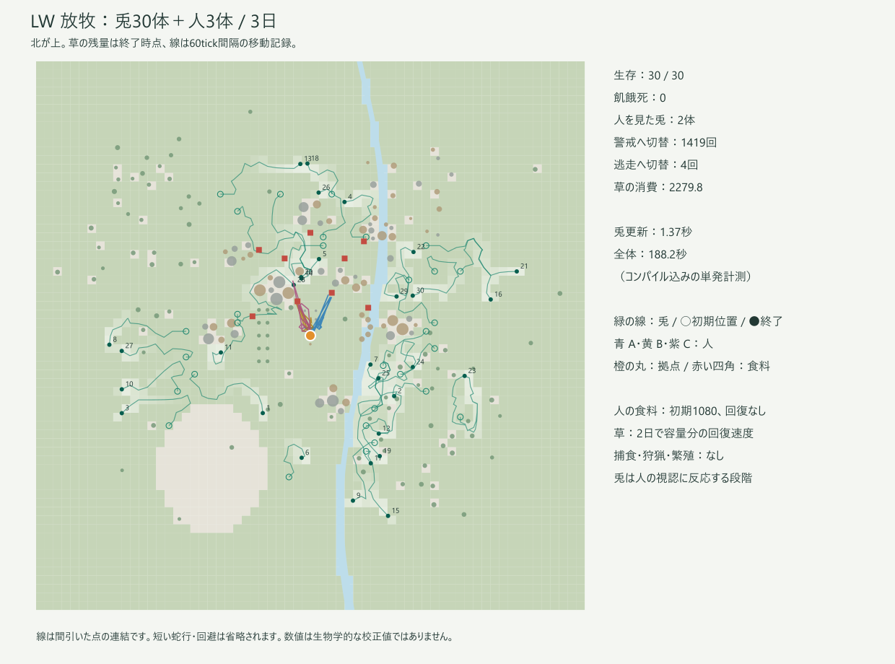

# 同じLW世界への放牧接続・3日試験

2026-10-28。Julia 1.13.1 / Windows / Julia・OpenBLAS各1スレッド。人3体、兎30体、3日。捕食者・狩猟・繁殖なし。

## 条件

既存の標準抽象度3日試験と`scene.wildlife`以外の入力が一致することを検査した。自然な岩地形、開放拠点、食料9か所×120=1080個・回復なし。人側の初日見学・日次荷下ろし、感度A=0.5/B=1/C=1、危険OFF、goal_cues・探索関係ONを維持。人の選択seed20261007、兎と草のseed20261028。兎は拠点から8〜40の草がある異なるセルへ配置。草は2mセルと群落属性を使い、2日で容量分の回復速度を持つ。

兎は既存の状態機械を使用し、近隣の採食・移動・休息・睡眠、人の視認による警戒・逃走を実行する。人はまだ兎を認識して行動を変えない。草と人用食料も別資源である。[設計と境界](../../docs/design/LW_Wildlife_Grazing.md)。

## 結果

| 指標 | 結果 |
| --- | ---: |
| 兎の生存 | 30/30、飢餓死0 |
| 最終エネルギー範囲 | 83.126〜85.359 |
| 人を視認した兎 | 2体 |
| 視認tickの合計 | 7006（人A=0、B=34、C=6972） |
| 警戒状態への切替 | 1419回 |
| 逃走状態への切替 | 4回・合計18tick |
| 兎の移動距離合計 | 810.6 |
| 移動が阻まれた回数 | 0 |
| 草の消費 | 2279.815 |
| 草の初期量／増加／残量 | 13905.279／1523.528／13148.991 |

警戒回数は遭遇数ではない。静かな対象の近くで、採食等から間欠的な見回しへ戻る切替を含む。30体全員が人に反応したわけではなく、短期の配置では接触したのは2体に限られた。

| 状態 | 全個体のtick数 |
| --- | ---: |
| 草を探す・移動 | 3999 |
| 採食 | 91398 |
| 休息 | 1111372 |
| 睡眠 | 346801 |
| 逃走 | 18 |
| 警戒 | 1612 |

合計1,555,200=30×51,840操作。草は初期＋回復＝消費＋残量を維持。消費した草と消化・胃内残量も一致した。

人は全員3日終了時に拠点付近、reserve A92.213/B92.230/C92.240。食料消費9、地面1059、共有12、補充0。放牧前の標準3日試験と、全行動回数・イベント・最終個体状態・MB・日末状態・日始状態が一致した。これは第一段階では兎が人の候補に入らず、人の乱数系列も変更しないことの確認で、狩猟や帰還の改善を示すものではない。

## 費用と検証

- LW呼出し188.231秒（コンパイル込み）、ピークRSS 1.487 GB、累積割当71.792 GB、GC7.472秒。
- 兎の観測・更新区間合計1.373秒、LW呼出し時間の約0.73%。日末保存・ログ・初期生成などを含む完全な追加費用ではない。
- 比較元の標準3日試験は180.655秒。単発・別時点・計測器も異なるため、差の7.58秒を全て兎の費用とはしない。
- 新規35項目PASS。遮蔽、広い視野、動きと草の遮蔽、警戒→逃走→解除、見失った対象の位置、有限資源収支、睡眠、モジュール保存を確認。うち4項目は実LWの2日連続実行と1日目コピーからの再開を比較し、兎・日別状態・人の操作数・MBが一致。
- 3日接続試験21項目PASS。既存の世界特徴31項目PASS。親MB・経路監査もPASS。

[保存集計](evidence/three-day.json)。生の入力・ソース凍結・日末コピー・人と兎の軌跡CSV・草の最終分布はローカル`outputs/wildlife-grazing-3d-20261028`に保存。

今回の範囲では、既存の軽い状態機械による放牧は小さな更新費用で接続できた。人側への動く対象の観測・MB接続、狩猟・繁殖、多数の遭遇や高密度時の費用はまだ評価していない。
