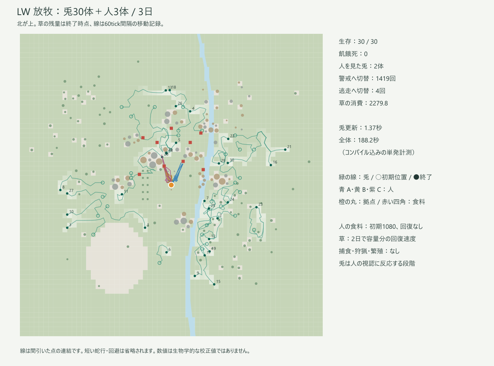

# 同じLW世界への放牧接続・3日試験

2026-10-28。Julia 1.13.1 / Windows / Julia・OpenBLAS各1スレッド。人3体、兎30体、3日。捕食者・狩猟・繁殖なし。

## 捕食者なし繁殖試験（2026-11-06追記）

`wildlife.reproduction=true` の初版。人の生活・取引は実行せず、現行LW地形と
初期位置に固定した人4体に対して、兎30体だけを90日更新した。
妊娠31日、離乳28日、成熟150日、雌雄各15体、季節性と栄養による妊娠判定。
暫定固定の幼体待機・母親の授乳帰巣を使用。捕食・病気・老衰はなし。
実測への適合や野生個体群の再現ではない。

| 草の初期量・容量・回復速度 | 出生 | 死亡 | 最終生存 | 実行時間 |
|---|---:|---:|---:|---:|
| 通常（倍率1） | 34 | 5 | 59 | 45.91秒 |
| 10分の1（倍率0.1） | 0 | 24 | 6 | 17.86秒 |

通常条件は妊娠9回、出産7腹、授乳174回、最終妊娠2体。
30日目29体、60日目63体、90日目59体。最終幼体依存数0で、生まれた個体はまだ成熟前。
死亡5体の内訳は初期成体1体と、母親ID12の幼体4体。
ID12は最終energy83.58だが移動のblocked累計16948で、
固定の局所帰巣が障害物で詰まり、授乳できなかった可能性がある。
従って死亡をすべて自然な草不足や生物学的な幼体死亡率と解釈しない。
草不足条件は妊娠2回・母体死亡による妊娠喪失1回・最終妊娠1体、出生0。

草・摂取・消化、妊娠投資、乳変換の診断は両試験とも許容誤差内。
通常条件の草収支残差は約−3.87e−6、相対約4.15e−11。
出力は `outputs/rabbit-breeding-90d-20261106-v2` と
`outputs/rabbit-breeding-poor-grass-90d-20261106`。ソース・条件・日次結果を保存。
最初の `outputs/rabbit-breeding-90d-20261106` はランナーのJuliaスコープ誤りで
初日記録時に停止。修正後は新規出力へ再実行し、凍結ソースは変更していない。

検査は繁殖26、動体観測14、放牧・保存再開35、計75項目PASS。
出生後の配列・出生からの状態tick・授乳収支・離乳境界・未成熟／雌だけ／栄養不足／季節外の
繁殖抑制・出生後のSerialization再開と、繁殖ONの実LW日末保存からの継続一致を確認した。
初回の保存再開検査は検査中にソースを更新したためコードハッシュ不一致で停止した。
ソース変更を止めて再実行し、保存・再開を含めて通過した。互換チェックは緩めていない。

## 母親12の帰巣追跡（2026-11-06）

`experiments/lw_wildlife/nursing_audit.jl` で通常90日の凍結ソース・同じ入力を再実行。
最終個体位置・energy・生存数・出生数が元結果と一致した。
証拠は `outputs/rabbit-nursing-audit-20261106`。本体の行動コードは変更していない。

58日終了時に幼体61〜64が出生。巣は(21.4221,-4.1135)。60日目に授乳した後、
61日目tick1036802で初めて帰巣中に衝突。母位置(17.6058,1.7146)、巣まで6.9663、
energy85.0112。妨げは中心(18.3722,1.3842)、半径0.45984の障害物。
巣の目標セル中心(21,-5)自体は通行可能で、授乳距離判定のずれが最初の原因ではない。

`configured_rabbit_nursing!` が毎tick同じ目標セルと `next_sense=t+1` を設定し、
通常のSEARCHが目標中心へ向きを計算する。衝突後の90度転回・target解除が次tickで
元に戻されるため、同じ場所へ直進し続ける。FLEE側の側方回避はSEARCHには適用されない。
対象期間の帰巣選択17548tickのうち16948tick（約96.6%）が衝突。警戒・逃走0tick。
途中で母体energyが35以下になると採食へ戻り、その移動によって偶然帰巣できることもある。

最初の衝突直前の同一状態を保存して3600tick比較。
元地形は3600回衝突・授乳なし。妨げた障害物1個だけ除いた診断分岐は衝突0、
29tick後に授乳し幼体4体のenergyが8へ回復した。
これは最初の閉塞の切り分けであり、岩を除去する修正や全期間の死亡改善試験ではない。

授乳にも別の仕様上の問題がある。`rabbit_nurse!` はわずかな乳量でも `nursed_day=day`
を設定する。61/63/71日目は母体維持床35までしか供給できず、授乳後の幼体energyは
1.516/2.309/2.488だったが、同日中は追加授乳候補にならない。
71日末には母体energy85.00まで回復したが、幼体の不足は日次済み判定に隠れた。
72日目tick1226969で4体ともenergy0。母体は83.92、位置(21.7939,-0.9014)で生存。

次の修正対象は、(1)帰巣目標を保持して局所的な障害回避を許す、
(2)授乳の接触・部分供給と、必要量を満たした完了を区別する、の二点。
この追跡では生態パラメータや行動を変更していない。

## 初回放牧試験の条件（2026-10-28）

既存の標準抽象度3日試験と`scene.wildlife`以外の入力が一致することを検査した。自然な岩地形、開放拠点、食料9か所×120=1080個・回復なし。人側の初日見学・日次荷下ろし、感度A=0.5/B=1/C=1、危険OFF、goal_cues・探索関係ONを維持。人の選択seed20261007、兎と草のseed20261028。兎は拠点から8〜40の草がある異なるセルへ配置。草は2mセルと群落属性を使い、2日で容量分の回復速度を持つ。

兎は既存の状態機械を使用し、近隣の採食・移動・休息・睡眠、人の視認による警戒・逃走を実行する。人はまだ兎を認識して行動を変えない。草と人用食料も別資源である。[設計と境界](../../docs/design/LW_Wildlife_Grazing.md)。

## 結果

| 指標 | 結果 |
| --- | ---: |
| 兎の生存 | 30/30、飢餓死0 |
| 最終エネルギー範囲 | 83.126〜85.359 |
| 人を視認した兎 | 2体 |
| 視認tickの合計 | 7006（人A=0、B=34、C=6972） |
| 警戒状態への切替 | 1419回 |
| 逃走状態への切替 | 4回・合計18tick |
| 兎の移動距離合計 | 810.6 |
| 移動が阻まれた回数 | 0 |
| 草の消費 | 2279.815 |
| 草の初期量／増加／残量 | 13905.279／1523.528／13148.991 |

警戒回数は遭遇数ではない。静かな対象の近くで、採食等から間欠的な見回しへ戻る切替を含む。30体全員が人に反応したわけではなく、短期の配置では接触したのは2体に限られた。

| 状態 | 全個体のtick数 |
| --- | ---: |
| 草を探す・移動 | 3999 |
| 採食 | 91398 |
| 休息 | 1111372 |
| 睡眠 | 346801 |
| 逃走 | 18 |
| 警戒 | 1612 |

合計1,555,200=30×51,840操作。草は初期＋回復＝消費＋残量を維持。消費した草と消化・胃内残量も一致した。

人は全員3日終了時に拠点付近、reserve A92.213/B92.230/C92.240。食料消費9、地面1059、共有12、補充0。放牧前の標準3日試験と、全行動回数・イベント・最終個体状態・MB・日末状態・日始状態が一致した。これは第一段階では兎が人の候補に入らず、人の乱数系列も変更しないことの確認で、狩猟や帰還の改善を示すものではない。

## 費用と検証

- LW呼出し188.231秒（コンパイル込み）、ピークRSS 1.487 GB、累積割当71.792 GB、GC7.472秒。
- 兎の観測・更新区間合計1.373秒、LW呼出し時間の約0.73%。日末保存・ログ・初期生成などを含む完全な追加費用ではない。
- 比較元の標準3日試験は180.655秒。単発・別時点・計測器も異なるため、差の7.58秒を全て兎の費用とはしない。
- 新規35項目PASS。遮蔽、広い視野、動きと草の遮蔽、警戒→逃走→解除、見失った対象の位置、有限資源収支、睡眠、モジュール保存を確認。うち4項目は実LWの2日連続実行と1日目コピーからの再開を比較し、兎・日別状態・人の操作数・MBが一致。
- 3日接続試験21項目PASS。既存の世界特徴31項目PASS。親MB・経路監査もPASS。

[保存集計](evidence/three-day.json)。生の入力・ソース凍結・日末コピー・人と兎の軌跡CSV・草の最終分布はローカル`outputs/wildlife-grazing-3d-20261028`に保存。

今回の範囲では、既存の軽い状態機械による放牧は小さな更新費用で接続できた。人側への動く対象の観測・MB接続、狩猟・繁殖、多数の遭遇や高密度時の費用はまだ評価していない。

## 2026-10-30: 長期収支の診断

90日試験は52日目、摂食累計約36,924.675に対する残差1.01226e-6が、旧絶対許容誤差1e-6を超えて停止した。51日目から再現し、その1日分をBigFloatで独立集計すると配分差は1.735e-18、世界側の累計加算誤差は4.087e-8だった。累計を丸めながら加算する際の誤差として扱う。

草の供給・残量、世界から個体への摂食、個体内の消化について、`balances`に符号付き残差（供給−計上）、絶対値の相対誤差、前回日末からの変化、観測済み最大絶対残差を保存する。残差は資源・身体量へ加減しない。日ごとの累積残差を合計することもしない。初回や診断のない旧保存状態では前回差はnull、最大値はその時点からの値となる。最終集計は最後の日末診断を再利用する。

暫定の数値許容方針（草の量の単位）:
- 規模 = max(abs(供給), abs(計上))。
- 警告境界 = 1e-6 + 1e-10 × 規模。
- 停止境界 = 1e-4 + 1e-8 × 規模。
- 境界以下なら続行、警告境界超過なら記録と警告で続行、停止境界超過または非有限値なら診断値付きで停止。

これらは物理的な散逸率ではなく、Float64の診断用許容幅であり、全規模で異常を識別できる保証ではない。長期化・個体数増加時には残差推移から再評価する。今回の規模では一口0.025相当の欠落・増加は停止検査で検出する。移動・死亡数・身体範囲等の検査は従来どおり。

検査: `julia --project=. experiments/lw_wildlife/balance_checks.jl`。実際の52日目停止状態でも3系統が許容範囲内となり、摂食累計と個体摂食値を変更せず通過した。90日完走はこの変更の検証には含まない。

## 帰巣ポテンシャルの同一保存状態比較（2026-11-06）

実装：授乳帰巣のSEARCHへ限定した引力＋近傍岩反発＋局所横移動。
既存の岩・人位置・母仔状態を保持し、`rabbit-nursing-audit-20261106/first-block.jls`から再開。
授乳完了判定は未変更。母親12、幼体61〜64。最初の状態はprepare済み。

`experiments/lw_wildlife/potential_checks.jl`で準備実行後、ON/OFFを交互順に各7回、3600tick測定。
旧方式：衝突3600、授乳なし、中央値0.073685秒。
新方式：衝突0、31tickで全仔energy8まで授乳、中央値0.0732589秒。
差は約0.6%で高速化とは判断しない。この短区間では顕著な増加なし。
同じ保存状態から3日継続では旧1.054315秒／新1.023249秒（各1回、性能優位の証拠ではない）。
旧は衝突11728、初授乳10787tick後、3日後の仔energy各0.004567。
新は衝突0、3日後の仔energy各7.999769。両方式とも4体生存。
全個体が障害物内に入っていないことを各比較で検査。既存繁殖26項目・動体観測14項目PASS。
保存：`outputs/rabbit-potential-check-20261106/result.json`（軌跡・各回時間・割当を含む）。

範囲：局所帰巣の実証。90日生存、凹地形、他の巣／シードの一般化は未検証。
授乳不足でも日次完了になる既知問題は別途修正が必要。全障害物の距離フィルタは残る。

## 初期幼体配置の検査（2026-11-06）

mixed-family初期条件を追加。成体30、初期妊娠5、別母親の7日齢幼体5、計35体。
初期幼体を出生統計へ混ぜず、通常の授乳・離乳を利用する。
reproduction_checks.jl: 49項目PASS（既存33＋親子初期配置16）。
初期位置／日齢／身体在庫／妊娠との排他／収支／100tickの巣待機／保存再開同値／離乳境界を検査。
離乳境界は複製状態の時刻を進めた単体検査で、21日間の生存を実行確認したものではない。
この新条件によるLW30日長期試験はまだ未実施。
