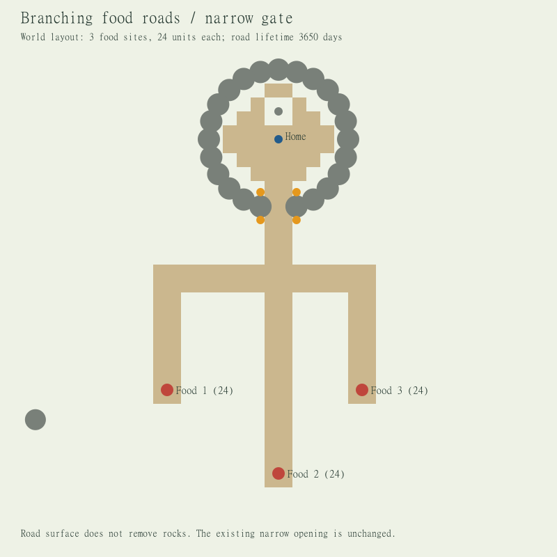

# 拠点と3つの食料地点をつなぐ分岐道

2026-10-25。World配置の追加。個体の観測・判断・学習コードは変更しない。

## 配置

狭い入口の拠点 `(0,6)` から南へ幹道を延ばし、`(0,-4)` で左・中央・右へ分岐する。各枝は次の食料地点に到達する。

| 枝 | 終点 | 初期食料 |
| --- | --- | ---: |
| 左 | `(-8,-12)` | 24 |
| 中央 | `(0,-18)` | 24 |
| 右 | `(6,-12)` | 24 |

既存の散在食料をこの3地点に置き換えた有限実験。拠点内の人工道、岩壁、入口、左右の光源、外の景観は維持する。食料総量は地点72＋初期携行4＝76。食料再生設定は既存のままで、全地点の食料が永久に枯渇しないという意味ではない。

道は1単位グリッドで幅2、寿命3650日の人工道。幹道・枝を合わせて112セル（拠点内の既存舗装と重複あり）。入口では既存の岩が通行幅を制限し、舗装しても岩は消えない。グリッド舗装が岩の下と重なる部分はあり、地面観測は既存の遮蔽処理を通す。

中心線が身体半径0.2で全区間通れること、路面セルが川に入らないこと、4近傍で拠点から全終点まで連結することを検査する。道の形・終点・食料との対応はWorld作成・実験observer用。個体には通常の地面観測だけを渡し、「この道は食料へ」「こちらが拠点」という意味は付与しない。

## 実行

```powershell
julia --startup-file=no --project=. experiments/rock_gate/run.jl outputs/food-roads-on-20261025 --narrow-only --days 1 --rho coarse --rho-openings on --food-roads on
julia --startup-file=no --project=. experiments/rock_gate/run.jl outputs/food-roads-off-20261025 --narrow-only --days 1 --rho coarse --rho-openings on --food-roads off
julia --startup-file=no --project=. experiments/rock_gate/compare_food_roads.jl
```

`--food-roads off`でも食料を同じ3地点へ配置し、拠点外の道だけを作らない比較条件。オプション省略は既存の岩壁実験のまま。`--prepare-only`で配置・幾何検査・入力・地図出力までを実行できる。

検証は同一配置・seed 20261005の1日比較。初回外出、各地点からの採取、道の候補選択、帰還状態を記録する。入場や地面候補の選択だけで帰還成功・道の行き先理解を判定しない。

## 1日結果

| 条件 | 外出した個体 | 左/中央/右の採取数 | 消費食料 | 帰還完了 |
| --- | ---: | --- | ---: | --- |
| 外道なし | 3/3 | 0 / 0 / 8 | 6 | Cの1回 |
| 外道あり | 3/3 | 5 / 0 / 3 | 6 | 0回 |

道ありでは左右の食料が採取され、中央は未採取。全枝の終点に食料は存在するが、全てを訪問・理解したことにはならない。1seed・1日の結果では帰還改善は見られず、道だけで帰還が解けるとはいえない。外道なしでも拠点内舗装と自然な踏み跡はある。

地面経路候補の選択回数は、なしがA244/B229/C246、ありがA247/B212/C272。これは拠点内や自然な踏み跡も含む全地面候補の回数で、追加した道に意図的に従った回数ではない。実行時間は70.92 / 78.79秒（コンパイル込み、行動差あり）。

各条件で道の構造19項目・岩壁配置33項目・生活保存則7項目、比較で道以外の入力一致など9項目、計127項目PASS。判断コードは変更していない。

証拠: [比較結果](evidence/food_roads/comparison.json)、[入力](evidence/food_roads/input.json)、[配置](evidence/food_roads/layout.json)、[実験コードhash](evidence/food_roads/source_hashes.json)。各runのmanifestとreportも同じディレクトリへ保存。


